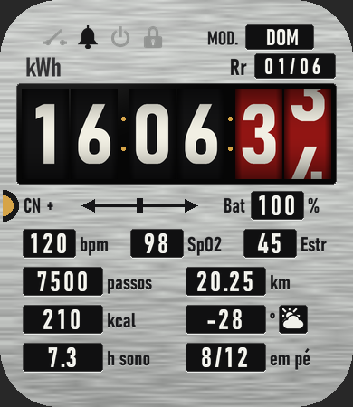
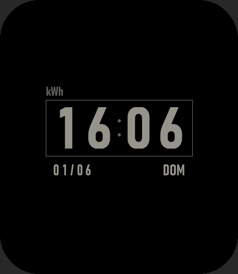

# Meter — Amazfit Bip 6 watchface

A residential energy meter on your wrist: brushed aluminium nameplate, `HH mm ss`
on rolling number wheels, and your stats stamped on the plate in the same boxed
`[120] V` style as the real thing.

 

| Part of the meter | Shows | Tap opens |
|---|---|---|
| `kWh` counter | Time on rolling wheels; seconds on red wheels, like a meter's fractional digits. Follows the watch's 12/24h setting. | — |
| `MOD.` box | Weekday | — |
| `Rr` box | dd/mm date | — |
| `Bat` box | Battery % | — |
| Spec rows | bpm, SpO2, stress, steps, km, kcal, temperature + weather, sleep (decimal hours), stand (x/12) | Each one's app (not km) |
| Top left | Status symbols, stamped faintly and inked when on: open switch (phone disconnected), bell (alarm), standby (DND), padlock (lock) | — |
| AOD | Dimmed time, date and weekday on black, no wheels | — |

Labels and the weekday follow the watch's language: Portuguese, Spanish, or English
for anything else.

## How the wheels work

`IMG_TIME` can only swap digits, so the wheels are six `IMG` widgets on top of it,
driven by a 100 ms timer that only runs while the screen is on. Every tick
compares the time to what each wheel shows, and a change plays a three-frame roll.
If the timer never runs the wheels stay hidden and `IMG_TIME` still shows the
right time.

## Files

- `design.py`: palette, layout, label translations and the wheel renderer. Edit this to change the look.
- `watchface/index.js`: the widgets and wheel logic. Its top block is generated by `design.py`.
- `check.js`: self-check for the wheel logic. Run `node Meter/check.js` after a build.
- `assets/bip6/`: generated images. Don't edit them by hand.

Build from the repo root with `python tools/build.py Meter`. See the
[root README](../README.md) for setup and installing on the watch.
