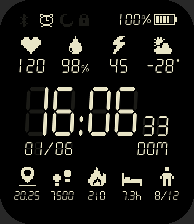
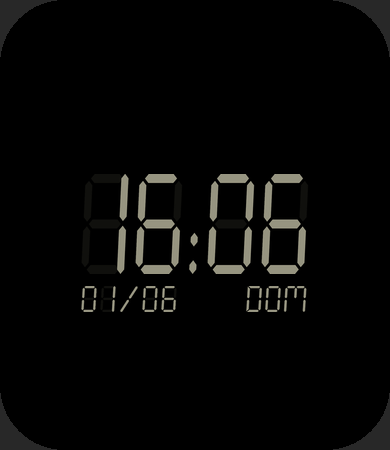
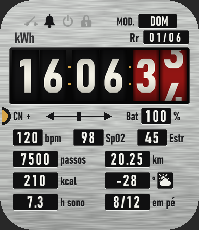
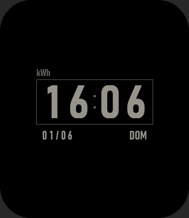

# ZeppOS Watchfaces

Free watchfaces for the Amazfit Bip 6, in English, Spanish and Portuguese.
Each face picks its language from the watch's system language.

| Face | Preview | Always-on | Download |
|---|---|---|---|
| [Retro](Retro/): Casio-style LCD |  |  | [Retro.zip](https://github.com/eitchtee/zeppos-watchfaces/releases/latest/download/Retro.zip) · [Retro.zab](https://github.com/eitchtee/zeppos-watchfaces/releases/latest/download/Retro.zab) |
| [Meter](Meter/): residential energy meter with rolling drums |  |  | [Meter.zip](https://github.com/eitchtee/zeppos-watchfaces/releases/latest/download/Meter.zip) · [Meter.zab](https://github.com/eitchtee/zeppos-watchfaces/releases/latest/download/Meter.zab) |

## Install

- **`.zip`**: install it with the AmazFaces app, or open it in ZeppOS Player 2.
- **`.zab`**: the official Zeus package. To put a face on the watch through the
  Zepp app, see [Installing via Zepp app developer mode](#installing-via-zepp-app-developer-mode).

## Build from source

Everything below is only needed to change a face or make a new one.

### Setup (once)

```sh
npm install          # Zeus CLI, local to this repo
pip install pillow
```

`npm install` also runs a `postinstall` step that links Zeus's bundled
`zeppos-app-utils` module. On npm 11, Zeus fails with
`Cannot find module 'zeppos-app-utils'` without it.

The Seven Segment font is free for personal use, so it isn't in this repo.
Download it from [dafont](https://www.dafont.com/seven-segment.font) and save it
as `tools/fonts/SevenSegment.ttf`.

Meter uses Bahnschrift, which ships with Windows 10 and later. On another
system, see the note at the top of `Meter/design.py`.

### Build

```sh
python tools/build.py Retro            # assets + zeus build + flat zip
python tools/build.py Retro --assets   # only redraw assets and previews
```

Outputs in `<Face>/dist/`:

- `<appName>.zip` is a flat single zip, the format used on amazfitwatchfaces.com.
  Open it in ZeppOS Player 2 or install it with AmazFaces.
- `*.zab` is the official Zeus package for the Zepp app and `zeus preview`.
  It is nested, so ZeppOS Player can't open it.

## Installing via Zepp app developer mode

1. In the Zepp app, go to Profile → Settings → About and tap the Zepp icon 7× to enable Developer Mode.
2. In the face folder, run `npx zeus login` (once), then
   `npx zeus preview -t "Amazfit Bip 6"`. Scan the QR code in Zepp app →
   Profile → Developer Mode → Scan. The code is valid for 7 days, and each
   new preview needs a new one.

## Shared tools

```
tools/
  build.py          design.py -> zeus build -> flat zip
  zepp/draw.py      ttf_glyphs: digit sets from a TTF (fixed LCD cells with a
                    ghost "8", or natural widths), ttf_word, hand-drawn
                    7-segment digits, colon, slash, 5x7 dot-matrix words,
                    pixel art, battery, °/%/. glyphs, text_img + mask_screen
                    for previews
  zepp/icons.py     pixel-art grids: heart, steps, flame, pin, BT, alarm, DND,
                    lock, arrows, weather (+ WEATHER_MAP for ZeppOS types 0-28)
  zepp/project.py   Bip 6 size, weekday names (WEEK: pt, en, es), pt-BR months, Face (asset saving,
                    layout injection into watchface/index.js)
  zepp/package.py   .zab -> flat zip
  fonts/            put SevenSegment.ttf here (Krafti Lab, not in the repo)
```

## Starting a new face

1. Copy `Retro/` to a new folder, minus `assets/`, `dist/` and the previews.
2. In `app.json`, change `appId` (any unused number) and `appName`.
3. Rewrite `design.py` and `watchface/index.js`. Keep the
   `// GENERATED LAYOUT START/END` markers in `index.js`; `face.write_layout(...)`
   fills that block.
4. Run `python tools/build.py <Face>`.

The face code uses API 1.0 (`hmUI`, `WatchFace({...})`) with no `import`s,
because ZeppOS Player runs the source file directly.

To add a face to the table above, link its files under
`releases/latest/download/`.

## Publishing a release

The download links point at the latest release, so each release must carry
every face. Upload `dist/<appName>.zip` and the `.zab` renamed to `<appName>.zab`:

```sh
cp Retro/dist/*.zab Retro/dist/Retro.zab
gh release create v1.1.0 Retro/dist/Retro.zip Retro/dist/Retro.zab
```
