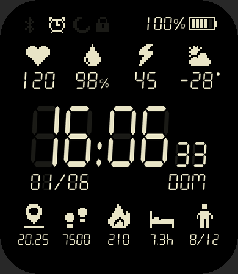
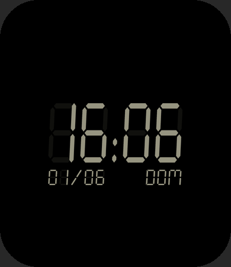

# Retro — Amazfit Bip 6 watchface

Casio-style LCD face: big 7-segment `HH:MM` with seconds, unlit "ghost"
segments, dd/mm date, weekday in the Seven Segment font,
pixel-art icons instead of text labels.

 

| Area | Shows | Tap opens |
|---|---|---|
| Status row | BT disconnected (x), alarm, DND, lock, battery % + bars | — |
| Top row | ♥ heart rate, 💧 SpO2 %, ⚡ stress, weather icon + temp | Each one's app |
| Center | big clock + seconds; dd/mm below left, weekday below right | — |
| Bottom | 📍 distance (km), 👣 steps, 🔥 kcal, 🛏 sleep (decimal hours, 7.3h), 🧍 stand (x/12) | Steps / Calories / Sleep / Stand |
| AOD | dimmed time, date, weekday | — |

The time follows the watch's 12/24h system setting.

The weekday follows the watch's language:

| Language | Weekdays |
|---|---|
| English (also the fallback for any other language) | MON TUE WED THU FRI SAT SUN |
| Spanish | LUN MAR MIE JUE VIE SAB DOM |
| Portuguese | SEG TER QUA QUI SEX SAB DOM |

## Files

- `design.py`: palette, font sizes, layout and which icons go where. Edit this to change the look.
- `watchface/index.js`: the widgets. Its top block is generated by `design.py`.
- `assets/bip6/`: generated images. Don't edit them by hand.

Build from the repo root with `python tools/build.py Retro`. See the
[root README](../README.md) for setup and installing on the watch.
